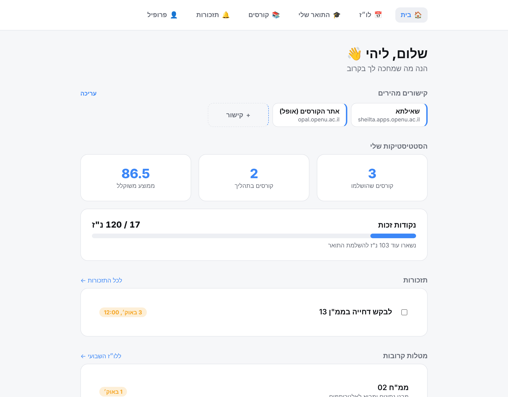
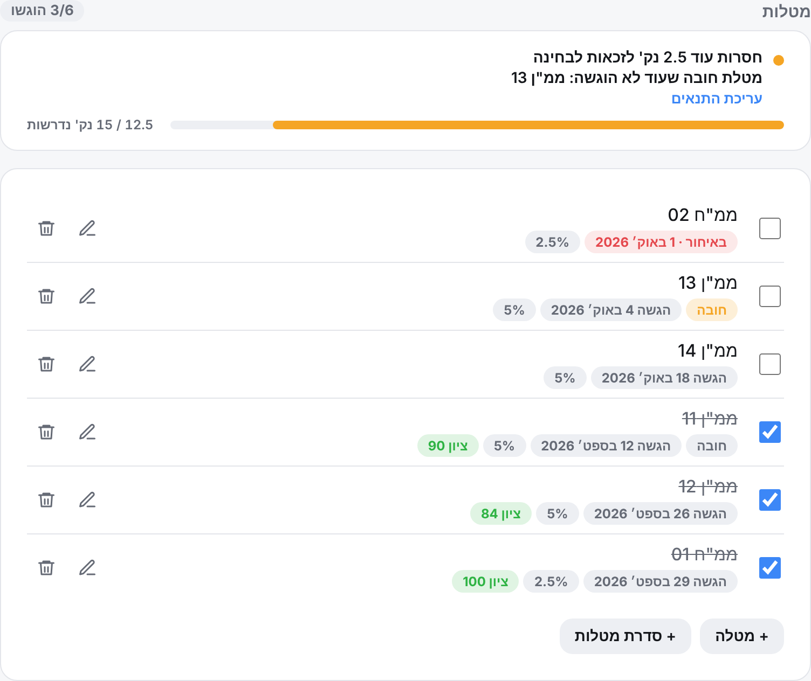
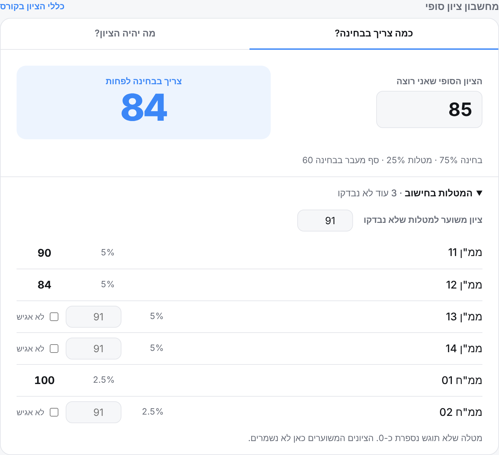
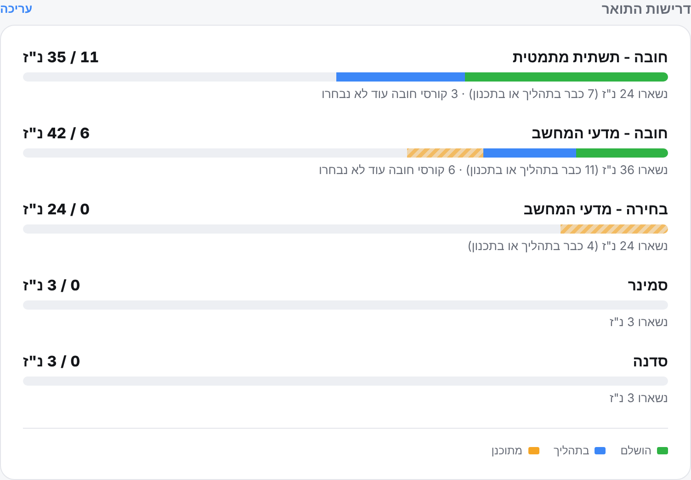
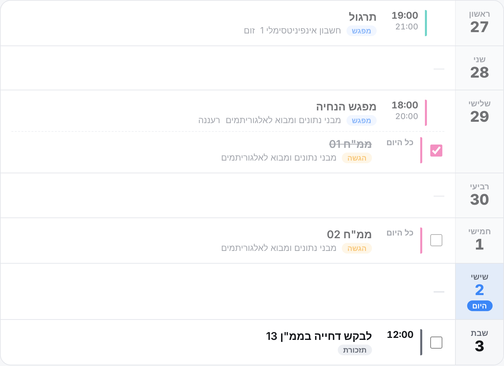
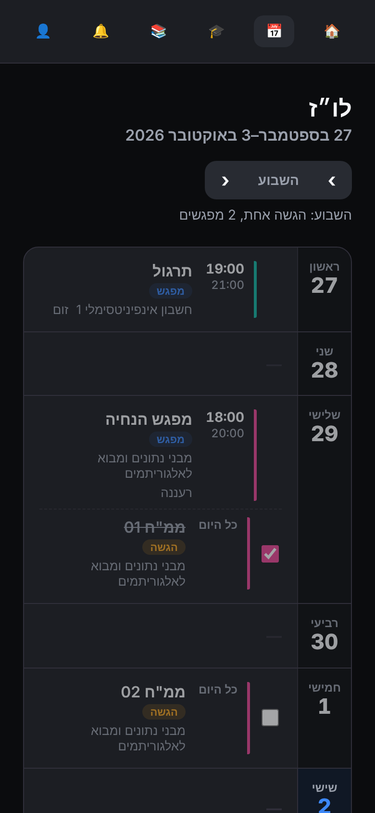
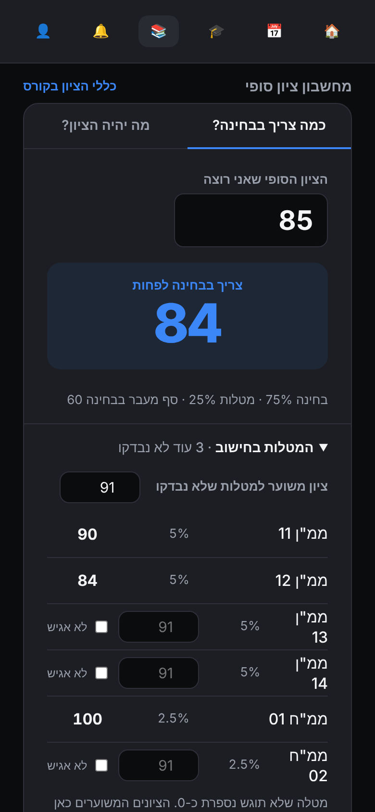

# OpuLi

**Your whole degree in one place: assignments, exams, credits and what's left to do this week.**

I started OpuLi because at the Open University the information is scattered across Sheilta, Opal, each course's booklet and one Excel sheet that kept getting messier. I wanted to open one place and know what's due this week, how many assignments are still missing before I can sit the exam, and how many credits are left until the degree.

This is the repo for the website and the server. The iPhone and Android app lives in [opu-li](https://github.com/Lraviv/opu-li).

<p align="center">
  
</p>

## What's inside

### Assignments, and what's missing before the exam
For each assignment you set its type (mmn or mmh), weight, due date and whether it's mandatory. If a course requires at least 3 assignments, or assignments worth 15 points, you see right away how many are still missing and which mandatory assignment hasn't been submitted. A whole series, for example mmn 11 to 14, is created in one click.



### What do I need on the exam?
Enter the final grade you want, and the calculator tells you what you need on the exam. It also works the other way: enter an exam grade and see what the final grade will be. The calculator takes into account the weights from the booklet, the exam pass mark and "shield" assignments. For assignments that haven't been graded yet, you can enter an estimated grade or mark "won't submit" and see how that changes the grade.



### Degree requirements
Set how many credits you need in each category (mandatory, elective, seminar, workshop) and see for each one what's done, what's in progress and what's only planned. In mandatory categories the requirement fills in automatically from the catalog, and next to it you also see how many mandatory courses you haven't picked yet.



### This week's schedule
Tutorial sessions (including biweekly ones), exams, due dates and reminders, day by day. You can mark an assignment as submitted right from the schedule.



### Calendar export
Create a personal subscription link and add it once to Google Calendar, Apple or Outlook. From then on, exams, due dates and sessions show up in your calendar and update on their own. If you prefer, you can also download an .ics file.

### Tips from other students
Every course has a "tips from students" tab: a shared discussion for everyone taking the same course at the same institution. Post tips and questions, reply in threads, and upvote or downvote anonymously. Sort by most recommended, newest or oldest.

### Community
A forum for every student at your institution, beyond a single course. Share tips, ask general questions, and organize study meetups and student parties. Events show the date and a general location; the exact address appears only after you RSVP, and the organizer sees the names and emails of who's coming. Upvote, save posts, comment in threads, and report anything that doesn't belong.

### And more
- Quick links to Sheilta, Opal, recordings and the exam archive, on the home screen and in every course
- Lesson tracking and study topics to prepare for the exam
- A semester planning board and weighted average
- A ready-made template for the Open University computer science degree, with 72 courses in the catalog
- Email reminders for assignments, exams and personal reminders
- Dark mode, and a choice of accent color

<p align="center">
  
  &nbsp;&nbsp;
  
</p>

---

## For developers

| | |
|---|---|
| `backend/` | FastAPI + SQLModel, Postgres (Cloud SQL), Alembic migrations. Runs on Cloud Run |
| `web/` | React + Vite + TanStack Query. Runs on Firebase Hosting |
| `docs/` | Planning documents and screenshots |

### Running locally

```bash
# Server (the development default is SQLite, no Docker needed)
cd backend
python3 -m venv .venv && source .venv/bin/activate
pip install -r requirements-dev.txt
uvicorn app.main:app --reload        # http://localhost:8000/docs

# Website (in another terminal)
cd web
npm install
npm run dev                          # http://localhost:5173
```

More details in [backend/README.md](backend/README.md) and [web/README.md](web/README.md).

### Tests

```bash
cd backend && pytest        # API: permissions, validation, calendar export, tips, forum
cd web && npm test          # grade and schedule logic, across several time zones
```

The grade, schedule and degree-requirement logic lives in `web/src/lib/`, as pure functions with no React. The exact same files also exist in the app, so both sides calculate the same thing.
