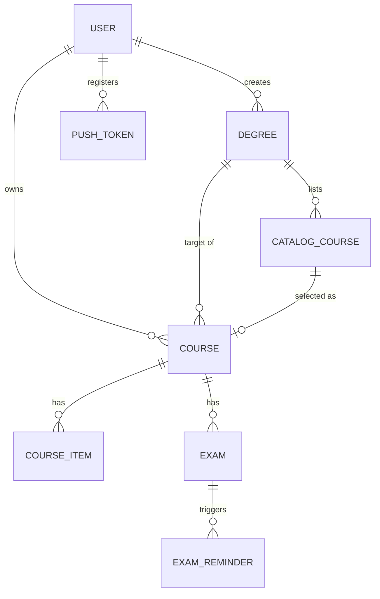
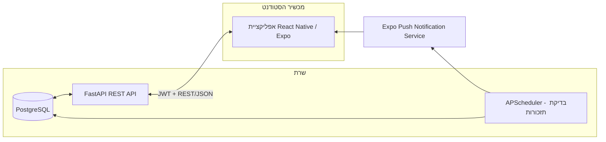

# מסמך איפיון — אפליקציית עזר לסטודנטים

**גרסה:** טיוטה ראשונה לדיון
**סטאק:** React Native (Expo) בפרונט, Python (FastAPI) בבאקנד

**סטטוס נוכחי:** כל ה-API של הבאקנד (סעיף 5) מומש ונבדק (`backend/`, כולל סוויטת `pytest`) — הרשמה/התחברות, תארים וקטלוג קורסים, קורסים אישיים ופריטי התקדמות, מבחנים עם תזכורות, טוקני Push, ו-endpoint פנימי לשליחת תזכורות. עדיין חסרה אפליקציית ה-React Native עצמה.

---

## 1. רקע ומטרה

אפליקציית מובייל (אנדרואיד + iOS) שמלווה סטודנטית/סטודנט לאורך התואר: מעקב אחרי קורסים ונקודות זכות, מעקב התקדמות בשיעורים ובמטלות, לוח מבחנים עם תזכורות, וציונים עם חישוב ממוצע. האפליקציה תומכת במשתמשים מרובים עם התחברות אישית, כך שכל סטודנט/ית רואה רק את הנתונים שלו/ה, וניתן להרחיב בעתיד לשיתוף בין חברים.

**מחוץ להיקף גרסה 1** (לדיון עתידי): לוח זמנים שבועי קבוע (מערכת שעות), שיתוף בין משתמשים, קבצים מצורפים למטלות.

---

## 2. משתמשים

- משתמש/ת נרשמים עם אימייל וסיסמה. לוגין עם Google אפשרי כשיפור עתידי, לא חובה לגרסה 1.
- כל הנתונים (קורסים, מטלות, מבחנים, ציונים) שייכים למשתמש בודד ולא נגישים לאחרים.
- אין כרגע דרישה לתפקידים שונים (סטודנט/מנהל) — כולם משתמשים רגילים.

---

## 3. היקף גרסה 1 — תכונות

### 3.1 תארים וקטלוג קורסים (חדש)
- כל משתמש/ת יכולים ליצור **תואר** (למשל "תואר ראשון במדעי המחשב, האוניברסיטה הפתוחה"): שם, מוסד, יעד נ״ז כולל לתואר. המערכת תומכת בכמה תארים/תבניות, כך שכל סטודנט/ית מגדירים את התואר שלהם בעצמם.
- לכל תואר יש **קטלוג קורסים** — רשימת הקורסים שניתן/צריך לקחת בתואר הזה (חובה/בחירה), שהמשתמש/ת מזינים ידנית פעם אחת (שם, נ״ז, קטגוריה, ואופציונלית סמסטר מומלץ). זהו "תפריט" הקורסים של התואר, בנפרד מהקורסים שבפועל לוקחים.
- **בחירת קורס מהקטלוג**: לוחצים על קורס בקטלוג ← "הוספה לקורסים שלי" ← נפתח טופס קצר לבחירת סטטוס (הושלם/בתהליך/מתוכנן), סמסטר וציון (אופציונלי) ← נוצר רשומת קורס אישית (ראו 3.2) המקושרת לקורס הקטלוג. קורס שכבר נבחר מסומן ככזה בתצוגת הקטלוג, כדי לדעת מה עוד נשאר לבחור.
- עדיין אפשר להוסיף קורס אישי **חופשי**, שלא מהקטלוג (למשל קורס מוכר מתואר קודם) — לשמירה על הגמישות שהייתה בגרסה הראשונה.
- **תבניות תואר מובנות**: יש קטלוג קורסים קבוע וזהה לכל המשתמשים (כרגע: "תואר ראשון במדעי המחשב, האוניברסיטה הפתוחה" - 72 קורסים, מבוסס על תוכנית הלימודים הרשמית). בזמן יצירת תואר אפשר לבחור תבנית כזו במקום למלא קטלוג ידנית - שם/מוסד/יעד נ״ז וכל קטלוג הקורסים (כולל קטגוריות: חובה-מתמטיקה, חובה-מדעי המחשב, בחירה, סמינר, סדנה) נטענים אוטומטית לתואר החדש. אפשר גם ליצור תואר "ריק" (ללא תבנית) ולמלא קטלוג בעצמכם, בדיוק כמו קודם. מקור הנתונים היחיד לתבניות: `backend/app/catalog_templates.py`.

### 3.2 הקורסים שלי — מעקב וחלוקה
- כל קורס שנבחר (מהקטלוג או ידנית) מקבל סטטוס: **הושלם / בתהליך / מתוכנן**, וקורסי המשתמש/ת מוצגים מחולקים לפי הסטטוס הזה (שלוש רשימות/טאבים), וגם מקובצים לפי סמסטר בתוך כל חלוקה.
- כרטיסי סיכום: נ״ז שהושלמו / בתהליך / מתוכננות, ויעד נ״ז אישי (נלקח אוטומטית מהתואר שנבחר, ניתן לשנות ידנית).

### 3.3 בניית מסלול לימודים לפי נק״ז וסמסטרים ✅ מומש
- למעשה הרחבה טבעית של 3.1+3.2: מסך "בניית מסלול" מציג את קורסי הקטלוג שעדיין **לא נבחרו**, ומאפשר לשבץ אותם ידנית לסמסטר עתידי (יוצר עבורם רשומת קורס בסטטוס "מתוכנן" עם הסמסטר שנבחר).
- תצוגת "סה״כ נ״ז חי" לכל סמסטר בתוכנית וסה״כ מצטבר לתואר, כדי לראות מייד אם סמסטר עמוס מדי או שיש עוד רחוק ליעד.
- לא כולל בגרסה 1: הצעה אוטומטית של סדר קורסים או בדיקת קדם-דרישות (Prerequisites) — נשאר לשיפור עתידי.

### 3.4 מעקב התקדמות (שיעורים ומטלות) ✅ מומש
- לכל קורס — רשימת פריטים (Checklist) מסוג "שיעור" או "מטלה", מוצגים בשני מדורים נפרדים במסך הקורס (לא רשימה מעורבת אחת): "שיעורים" ו"מטלות".
- לשיעור: כותרת, וסימון "נצפה"/לא (`is_done`).
- למטלה: כותרת, תאריך יעד (אופציונלי), סימון "הוגש"/לא (`is_done`), משקל אופציונלי (`weight_percent` - כמה אחוזים מהציון הסופי של הקורס המטלה שווה, למשל 10 = 10%), וציון שהתקבל בפועל באותה מטלה (`grade`, בנפרד מ-`weight_percent` ומהציון הסופי הכולל של הקורס). מסך הקורס מציג "הוגשו מטלות בשווי X% מתוך Y%" לפי סכימת המשקלים שהוגדרו. למטלה (בשונה משיעור) יש גם עריכה ומחיקה מפורשות מהרשימה, לא רק לחיצה ארוכה.
- תצוגת "מטלות קרובות" מרוכזת בדף הבית (`GET /course-items`, כל המטלות הפתוחות מכל הקורסים), ממוינת לפי תאריך יעד, עם הדגשה באדום למטלות באיחור.

### 3.5 לוח מבחנים ותזכורות
- לכל קורס — הוספת מבחן: תאריך ושעה, מיקום (אופציונלי), הערות.
- תצוגה מרוכזת של כל המבחנים הקרובים (across כל הקורסים), ממוינת כרונולוגית.
- **התראות Push**: ברירת מחדל של תזכורת יום לפני + שעתיים לפני מבחן; ניתן להגדיר תזמון תזכורת מותאם אישית לכל מבחן, ו/או ברירת מחדל גלובלית בהגדרות המשתמש.

### 3.6 ציונים וממוצע
- שדה ציון (0–100) אופציונלי לכל קורס שהושלם.
- חישוב ממוצע משוקלל לפי נ״ז (רק קורסים בסטטוס "הושלם" עם ציון קיים) — מוצג בדף הבית.
- הרחבה עתידית אפשרית: מספר רכיבי ציון לקורס (מטלה 20% + מבחן 80%) — לא בגרסה 1, כדי לשמור על מבנה גמיש ופשוט.

---

## 4. מודל נתונים

ישויות עיקריות (PostgreSQL, יחסי):

```
User
 ├─ id, email, password_hash, display_name, created_at

Degree (שייך ל-User שיצר אותו)                      ← חדש
 ├─ id, user_id, name, institution (text, למשל "האוניברסיטה הפתוחה"),
 │  target_credits (number), created_at

CatalogCourse (שייך ל-Degree — "תפריט" הקורסים של התואר)   ← חדש
 ├─ id, degree_id, name, credits, category (text, optional: חובה/בחירה...),
 │  recommended_semester (text, optional), notes (optional)

Course (שייך ל-User; זהו הקורס שבפועל "עושים")
 ├─ id, user_id, degree_id (optional), catalog_course_id (optional, אם נבחר מקטלוג),
 │  name, credits, semester (text), status (done|current|planned),
 │  category (text, optional), grade (number, optional), created_at

CourseItem (שייך ל-Course)  — שיעורים ומטלות באותה טבלה, מובחנים ב-type
 ├─ id, course_id, type (lesson|assignment), title, due_date (optional),
 │  is_done (bool), order (int, optional)

Exam (שייך ל-Course)
 ├─ id, course_id, date_time, location (optional), notes (optional)

ExamReminder (שייך ל-Exam)
 ├─ id, exam_id, offset_minutes (כמה זמן לפני המבחן להתריע), sent_at (nullable)

PushToken (שייך ל-User)
 ├─ id, user_id, expo_push_token, device_info, created_at
```

`Course.name`, `credits`, `category` מועתקים (snapshot) מה-`CatalogCourse` בזמן הבחירה — כך שעריכה מאוחרת של הקטלוג לא משנה רטרואקטיבית קורסים שכבר נבחרו, וקורס אישי (לא מהקטלוג) פשוט משאיר `catalog_course_id` ריק.

דיאגרמת יחסים:



---

## 5. API — FastAPI (REST, JSON, JWT Bearer Auth)

| Method | Path | תיאור |
|---|---|---|
| POST | `/auth/register` | הרשמה (email, password, display_name) |
| POST | `/auth/login` | התחברות → מחזיר access + refresh token |
| POST | `/auth/refresh` | חידוש access token |
| GET | `/me` | פרטי המשתמש המחובר |
| GET | `/degree-templates` | רשימת תבניות תואר מובנות (מפתח, שם, מוסד, יעד נ״ז, מס' קורסים) |
| GET | `/degrees` | רשימת התארים שיצר המשתמש |
| POST | `/degrees` | יצירת תואר (שם, מוסד, יעד נ״ז, ואופציונלית `template` - מפתח תבנית שטוען אוטומטית את כל קטלוג הקורסים שלה) |
| PUT | `/degrees/{id}` | עדכון תואר |
| DELETE | `/degrees/{id}` | מחיקת תואר |
| GET | `/degrees/{id}/catalog` | קטלוג הקורסים של התואר |
| POST | `/degrees/{id}/catalog` | הוספת קורס לקטלוג |
| PUT | `/catalog-courses/{id}` | עדכון קורס בקטלוג |
| DELETE | `/catalog-courses/{id}` | מחיקת קורס מהקטלוג |
| POST | `/catalog-courses/{id}/select` | בחירת קורס מהקטלוג → יוצר `Course` אישי (status, semester, grade בגוף הבקשה) |
| GET | `/courses` | רשימת קורסים של המשתמש (אפשר לסנן לפי `degree_id`, `status`) |
| POST | `/courses` | יצירת קורס |
| PUT | `/courses/{id}` | עדכון קורס |
| DELETE | `/courses/{id}` | מחיקת קורס |
| GET | `/courses/{id}/items` | שיעורים/מטלות של קורס |
| POST | `/courses/{id}/items` | הוספת פריט |
| PUT | `/items/{id}` | עדכון פריט (למשל סימון בוצע) |
| DELETE | `/items/{id}` | מחיקת פריט |
| GET | `/exams` | כל המבחנים הקרובים של המשתמש (מכל הקורסים) |
| POST | `/courses/{id}/exams` | הוספת מבחן לקורס |
| PUT | `/exams/{id}` | עדכון מבחן |
| DELETE | `/exams/{id}` | מחיקת מבחן |
| POST | `/push-tokens` | רישום טוקן Push של המכשיר |
| DELETE | `/push-tokens/{token}` | הסרת טוקן (למשל בהתנתקות) |

תיעוד ה-API ייווצר אוטומטית ע״י FastAPI (Swagger / OpenAPI) — נוח לבדיקות תוך כדי פיתוח.

---

## 6. מסכים וניווט (React Native + Expo Router) ✅ מומש

**עדכון מהמימוש בפועל:** בזמן הבנייה הוחלט להשתמש ב-[Expo Router](https://docs.expo.dev/router/introduction/) (ניווט מבוסס-קבצים, מבוסס React Navigation מתחת למכסה המנוע) במקום חיווט ידני של `@react-navigation` — זו כרגע ברירת המחדל המומלצת של Expo לפרויקטים חדשים (SDK 57), כולל תבנית האימות המובנית `Stack.Protected` (guard boolean על מסכים, ראו סעיף 7). המבנה בפועל (`mobile/src/app/`):

**שורש (`_layout.tsx`)** — `Stack.Protected`: אם אין session מפנה ל-`sign-in.tsx`, אחרת ל-`(app)`.

**מסך התחברות/הרשמה (`sign-in.tsx`)** — מסך אחד עם toggle בין התחברות להרשמה (אימייל, סיסמה, שם תצוגה).

**ניווט ראשי `(app)/` (טאבים תחתונים, אחרי התחברות):**

1. **בית** (`index.tsx`) — כרטיסי סיכום: נ״ז שהושלמו מול יעד, ספירת קורסים לפי סטטוס, המבחן הקרוב, ו"מטלות קרובות" (ראו 3.4) - עד 6 מטלות פתוחות מכל הקורסים, ממוינות לפי תאריך יעד, עם הדגשה אדומה למטלות באיחור.
2. **התואר שלי** (`degree/`) — רשימת תארים + הוספה (כולל בחירת תבנית מוכנה, ראו 3.1) ← מסך תואר בודד: קטלוג הקורסים שלו (הוספה/עריכה), תגית "כבר נבחר" לכל קורס, ובחירת קורס עם סטטוס ישירות מהרשימה; סיכום נ״ז שהושלמו מול היעד; כפתור "בניית מסלול לימודים" ← מסך `degree/[id]/plan.tsx`: קורסי הקטלוג שעדיין לא נבחרו עם שיבוץ ידני לסמסטר (יוצר קורס בסטטוס "מתוכנן"), וסיכום נ״ז לפי סמסטר + סה״כ מצטבר מול יעד התואר. אפשרות לנהל כמה תארים.
3. **הקורסים שלי** (`courses/`) — טאבים פנימיים לפי סטטוס (בתהליך / מתוכננים / הושלמו), כרטיסי קורס עם פס צבע לפי סטטוס + הוספת קורס ידנית ← מסך פרטי קורס: שינוי סטטוס, עריכת ציון, "שיעורים" ו"מטלות" כשני מדורים נפרדים (לשיעור סימון "נצפה", למטלה סימון "הוגש" + תאריך יעד + משקל % מהציון, עם סיכום משקל שהוגש מתוך הכולל), רשימת מבחנים (הוספה עם בורר תאריך+שעה, מחיקה), מחיקת קורס.
4. **לוח מבחנים** (`exams.tsx`) — כל המבחנים הקרובים מכל הקורסים, ממוינים לפי תאריך.
5. **פרופיל** (`profile.tsx`) — פרטי משתמש, הפעלת/כיבוי התראות Push, "הצעת פיצ׳ר חדש" (פותח מייל ל-כתובת שמוגדרת ב-`EXPO_PUBLIC_FEEDBACK_EMAIL`), התנתקות.

**מה נשאר לשלב הבא:** "בניית מסלול" היא כרגע שיבוץ ידני בלבד (בוחרים סמסטר לכל קורס) - הצעה אוטומטית של סדר קורסים לפי קדם-דרישות נשארת לשיפור עתידי (ראו 3.3); "בדיקת מינימום מטלות" (למשל התראה אם עוד לא הוגשו מספיק מטלות כדי לצבור אחוז מסוים מהציון) לא מומשה - כרגע רק מוצג סכום המשקל שהוגש מתוך הכולל.

---

## 7. סטאק טכנולוגי וארכיטקטורה

**פרונטאנד — React Native עם Expo (Managed Workflow)** ✅ מומש (`mobile/`)
- Expo מאפשר לבדוק על המכשיר האמיתי מהר מאוד דרך Expo Go, ותומך בבנייה לחנויות (EAS Build) בהמשך בלי לשנות קוד.
- ניווט: `expo-router` (ניתוב מבוסס-קבצים, כולל `Stack.Protected` לאימות) — ראו הערה בסעיף 6.
- ניהול קריאות שרת ומטמון: `TanStack Query` (React Query) — טיפול נוח ב-loading/error/refetch.
- שמירת טוקנים: `expo-secure-store` (מוצפן במכשיר).
- התראות Push: `expo-notifications` (מבקש הרשאה, שולף Push Token, נרשם מול `/push-tokens` בבאקנד).
- בורר תאריך/שעה למבחנים: `@react-native-community/datetimepicker`.
- עיצוב: **shadcn/ui ו-Chakra UI הן ספריות ל-React (דפדפן) ולא תואמות ל-React Native** - הן בנויות על DOM/CSS ולא ניתנות להתקנה באפליקציית מובייל. במקום זאת נבנה סט רכיבים עקבי משלנו (`mobile/src/components/ui/`: `Card`, `Button`, `TextField`, `FormModal`) שמשתמש בפלטת הצבעים/ה-spacing הקיימים (`constants/theme.ts`) עם צל עדין ופינות מעוגלות אחידות. חלופות עתידיות אם ירצו קיט מוכן: `react-native-paper` (Material Design, בשל ותומך במצב כהה) או `tamagui`/`gluestack-ui` (גמישים יותר, בסגנון "owning the code" הדומה לשאנד-סי-אן).
- כתובת השרת מוגדרת דרך משתנה סביבה `EXPO_PUBLIC_API_URL` (ברירת מחדל: `http://localhost:8000`).

**באקנד — Python + FastAPI**
- FastAPI: מהיר לפיתוח, טיפוסים חזקים עם Pydantic (מתאים למבנה הגמיש שרצינו — שדות אופציונליים מאומתים בבירור), ותיעוד API אוטומטי.
- ORM: `SQLModel` (משלב Pydantic + SQLAlchemy, מתחבר טבעי ל-FastAPI) + `Alembic` למיגרציות.
- מסד נתונים: PostgreSQL — מתאים למבנה יחסי (משתמש → קורסים → פריטים/מבחנים).
- אימות: JWT (access + refresh tokens), סיסמאות מוצפנות עם `passlib[bcrypt]`.
- תזמון תזכורות: `APScheduler` בתוך שירות הבאקנד מפעיל משימה שבודקת אילו `ExamReminder` הגיע זמנם ולא נשלחו, ושולחת Push דרך `expo-server-sdk-python`. **בגלל שהאירוח החינמי "נרדם" בזמן חוסר פעילות (ראו סעיף האירוח למטה), המשימה הפנימית לבדה לא תמיד תרוץ בזמן** — לכן במקביל נוסיף טריגר חיצוני וחינמי (למשל cron-job.org או GitHub Actions מתוזמן) שקורא כל 15–30 דקות לנתיב ייעודי כמו `/internal/check-reminders`; זה גם מפעיל את הבדיקה בזמן וגם "מעיר" את השרת. מספיק לגרסה 1; אם יידרש בעתיד קנה מידה גדול יותר אפשר לעבור ל-Celery + Redis ואירוח בתשלום.

**דיאגרמת ארכיטקטורה כללית:**



**החלטות עדכניות:**
- **התחברות עם Google** — נדחה לעתיד; בגרסה 1 רק אימייל+סיסמה.
- **אירוח (חינמי) — הוחלט:**
  - **באקנד (FastAPI):** [Render](https://render.com/docs/free) — שירות Web חינמי לצמיתות (לא ניסיון מוגבל בזמן), 750 שעות מכונה חינם בחודש שמספיקות בנוחות לפרויקט אישי. החיסרון: השירות "נרדם" אחרי 15 דקות בלי תנועה, ובקשה ראשונה אחרי שינה לוקחת כדקה להתעורר — קביל לאפליקציה אישית.
  - **מסד נתונים (PostgreSQL):** [Neon](https://neon.com/pricing) — Postgres חינמי לצמיתות (בניגוד ל-Postgres החינמי של Render עצמו, שנמחק לגמרי אחרי 30 יום!). כולל ~0.5GB אחסון ו-100 שעות-מחשוב בחודש, שנמחקים לחישוב "ל-0" אחרי 5 דקות חוסר פעילות אך **הנתונים נשמרים** ומתעוררים אוטומטית עם החיבור הבא. חלופה שקולה: Supabase (500MB, אך דורש הפעלה ידנית אם הפרויקט "מושהה" אחרי שבוע של אי-פעילות).
  - למה לא Railway / Fly.io: שניהם עברו למודל של תקופת ניסיון בתשלום (קרדיט חד-פעמי ואז חיוב) ואין להם עוד מסלול חינמי מתמשך אמיתי נכון ל-2026.
  - **חלופה: Google Cloud (GCP)** — [Cloud Run](https://cloud.google.com/run/pricing) מציע Always Free אמיתי ומתמשך (2 מיליון בקשות + 180K שניות-vCPU + 360K GiB-שניות זיכרון בחודש, ללא תפוגה), כך שבשילוב עם Neon לאחסון זה נשאר **0 ₪/חודש** בדיוק כמו Render — יתרון: אין מגבלת "750 שעות" חודשית ומדיניות "0 עלות בתוך המכסה" ברורה יותר; חיסרון: דורש הזנת כרטיס אשראי בחשבון Google Cloud גם אם נשארים בתוך המכסה החינמית (ב-Render לרוב לא נדרש). **חשוב:** מסד הנתונים המנוהל של גוגל עצמו, Cloud SQL, **אינו חינמי** — גם המופע הזול ביותר (db-f1-micro) מחויב כל הזמן שהוא רץ, כ-9$ לחודש (מכונה + אחסון), כי הוא לא "נרדם" כמו Neon. חשבון חדש ב-GCP מקבל 300$ קרדיט חד-פעמי לניסיון (ל-90 יום), אך זה לא תחליף למסלול חינמי קבוע. **מסקנה:** בין Render+Neon ל-Cloud Run+Neon העלות זהה (0 ₪); ההבדל הוא בעיקר בנוחות ההרשמה (Render לא דורש כרטיס אשראי) מול פחות מגבלות שימוש (Cloud Run). Cloud SQL כדאי לשקול רק אם בעתיד עוברים לתשתית GCP מלאה בתשלום.
  - ראו גם את ההערה על תזמון תזכורות למעלה — האירוח החינמי דורש טריגר חיצוני כדי שההתראות יישלחו בזמן.
- מדיניות שמירת סיסמאות/אבטחה מורחבת (rate limiting, אימות אימייל) — נדרש בסיס, ניתן להעמיק בהמשך.

---

## 8. שלבי עבודה מוצעים

1. ✅ **הושלם** — הקמת שלד הבאקנד: מודלים, מסד נתונים, הרשמה/התחברות (JWT).
2. ✅ **הושלם (באקנד + אפליקציה)** — מסך "התואר שלי": תארים וקטלוג קורסים, בחירה מקטלוג עם סטטוס.
3. ✅ **הושלם (באקנד + אפליקציה)** — מסכי קורסים: בחירה מהקטלוג / הוספה ידנית, סינון לפי סטטוס/תואר, מסך פרטי קורס.
4. ⏳ בניית מסלול אוטומטית לפי נק״ז/סמסטרים: כרגע יש רק שיוך סמסטר מומלץ ידני לכל קורס בקטלוג (לא שיבוץ/חלוקה אוטומטית) — נשאר לשלב הבא.
5. ✅ **הושלם (באקנד + אפליקציה)** — פריטי התקדמות (שיעורים/מטלות): סימון בוצע, הוספה, מחיקה. תאריך יעד (due date) קיים בבקאנד אך עוד לא נחשף ב-UI.
6. ✅ **הושלם (באקנד + אפליקציה)** — מבחנים + תזכורות Push: הוספת מבחן עם בורר תאריך/שעה, הפעלת התראות ממסך הפרופיל (כולל endpoint פנימי `/internal/check-reminders` שמחכה לטריגר חיצוני מתוזמן, ראו סעיף האירוח — עדיין לא הוגדר בפועל).
7. ✅ **הושלם (באקנד + אפליקציה)** — עריכת ציון לקורס שהושלם + תצוגת נק״ז שהושלמו מול היעד בדף הבית.
8. ⏳ ליטוש: אימות אימייל/rate limiting בבאקנד, בדיקות אוטומטיות לאפליקציה, הגדרת הטריגר החיצוני לתזכורות, ולבסוף פריסה בפועל (Render/Cloud Run + Neon) ו-EAS Build לחנויות.

**מצב נוכחי:** גם הבאקנד וגם אפליקציית ה-Expo/React Native כתובים, מותקנים ומאומתים (`mobile/`: `tsc --noEmit` ו-`expo export --platform web` עוברים נקי) בתיקייה `opu-li` על המחשב. השלב הבא בפועל הוא הרצה ידנית משולבת (שרת + אפליקציה יחד) ובדיקה על מכשיר/סימולטור אמיתי.

---

*מסמך זה הוא בסיס לדיון — נשמח לשמוע הערות/שינויים לפני תחילת הפיתוח בפועל.*
